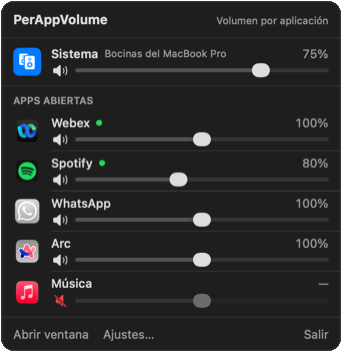
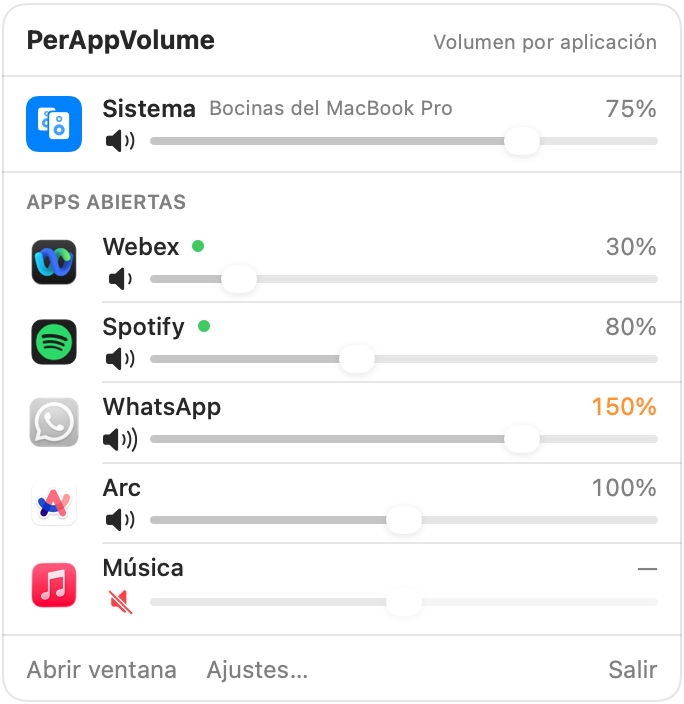
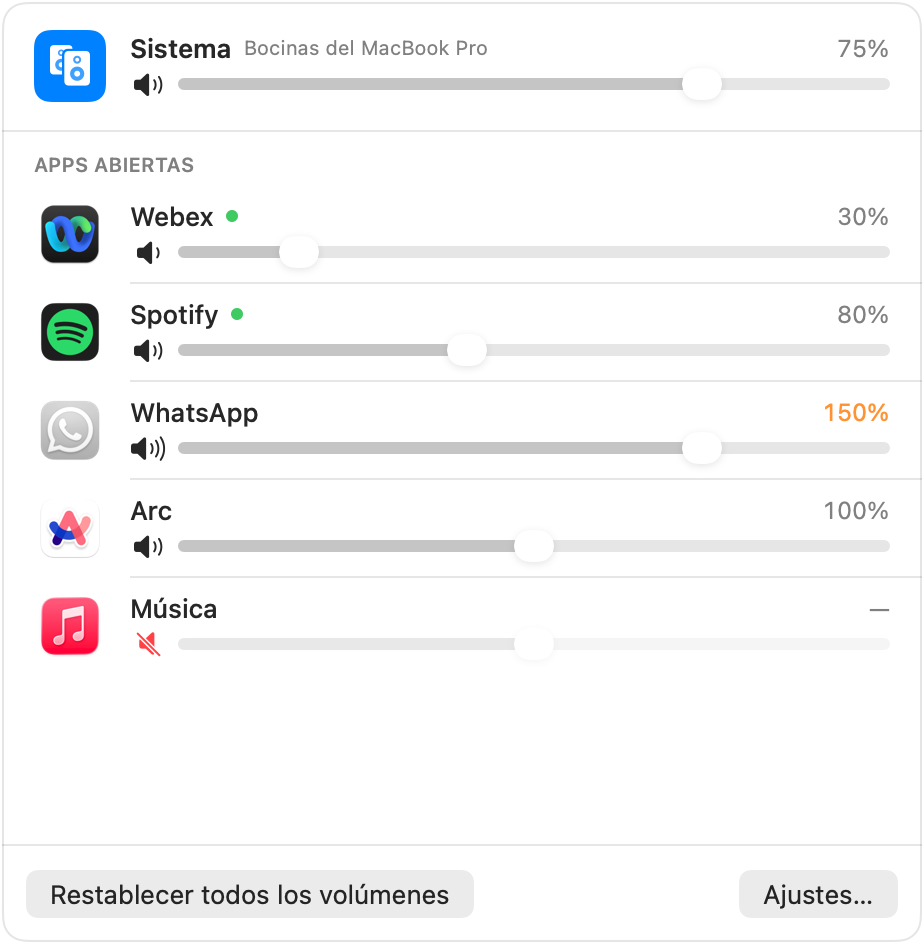
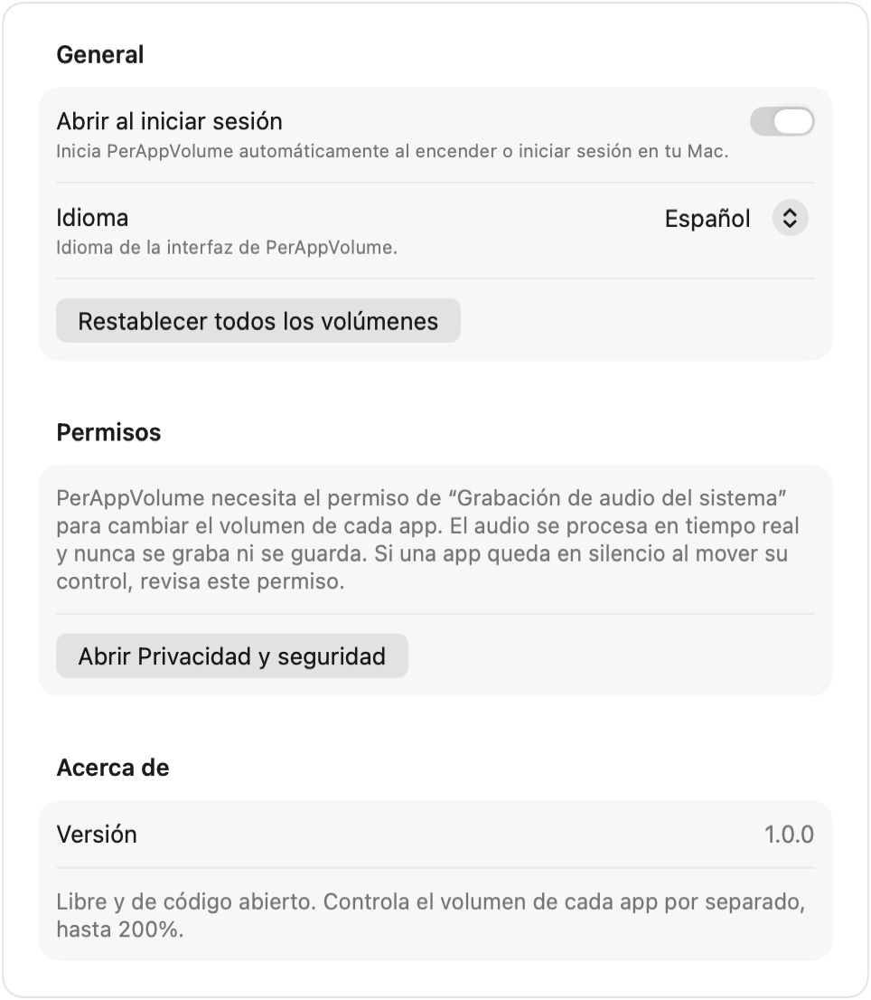

<p align="center">
  
</p>

<h1 align="center">PerAppVolume</h1>

<p align="center">
  <b>Controla el volumen de cada aplicación de tu Mac por separado.</b><br>
  Baja una llamada de Webex/Zoom que suena muy fuerte y mantén alta tu música, tus videos o los audios de WhatsApp.
</p>

<p align="center">
  <a href="README.md">🇺🇸 English</a> · 🇪🇸 Español
</p>

<p align="center">
  
</p>

---

macOS tiene un solo control de volumen para todo. PerAppVolume agrega lo que Windows tiene desde hace años: **un control de volumen para cada app**, en la barra de menú.

- 🎚️ **Volumen por app** de 0% a **200%** (sube las apps que suenan muy bajo)
- 📋 **Todas las apps abiertas** aparecen en la lista, con un **punto verde** en las que están sonando en ese momento
- 🔊 **Volumen del sistema** y silencio de tu salida de audio actual, en el mismo panel
- 🔇 **Silencia** una sola app sin tocar las demás
- 💾 **Recuerda** el volumen de cada app, incluso después de reiniciar el Mac
- 🖥️ **Panel en la barra de menú** y una **ventana más grande** opcional
- 🚀 **Se abre al iniciar sesión** (se puede desactivar en Ajustes)
- 🌍 **Español e inglés**, se cambia desde Ajustes
- 🎧 **Sigue tu salida de audio**: si pasas de parlantes a AirPods, sigue funcionando
- 🧩 **Sin drivers ni contraseña de administrador**: usa los *process taps* nativos de Core Audio de Apple. Para desinstalarla basta con borrar la app
- 🆓 Gratis y de código abierto (MIT)

## Capturas

| Panel de la barra de menú | Ventana del mezclador | Ajustes |
| :---: | :---: | :---: |
| <picture><source media="(prefers-color-scheme: dark)" srcset="docs/screenshots/menu-es-dark.png"></picture> | <picture><source media="(prefers-color-scheme: dark)" srcset="docs/screenshots/window-es-dark.png"></picture> | <picture><source media="(prefers-color-scheme: dark)" srcset="docs/screenshots/settings-es-dark.png"></picture> |
| Arriba el volumen del sistema y debajo todas las apps abiertas. El punto verde marca las que están sonando; el naranja indica que se subió por encima de 100%. | El mismo mezclador en una ventana que se puede agrandar, con *Restablecer todos los volúmenes*. | Abrir al iniciar sesión, idioma, permisos y versión. |

Las capturas siguen el tema de tu GitHub (claro u oscuro).

## Requisitos

- macOS **14.2 (Sonoma) o posterior**
- Mac con Apple Silicon o Intel (app universal)

## Instalación

### Con un solo comando

Abre **Terminal** y ejecuta:

```bash
curl -fsSL https://raw.githubusercontent.com/barcodaniel501/PerAppVolume/main/scripts/install.sh | bash
```

Descarga la última versión, la instala en **Aplicaciones**, le quita la cuarentena de descarga (para que macOS no la bloquee) y la abre. La encontrarás en la barra de menú; sigue con [Permiso](#permiso-grabación-de-audio-del-sistema).

> 🤖 **¿Usas un agente de IA** (Claude Code, Codex, Cursor…)? Pídele “instala PerAppVolume siguiendo AGENTS.md”. Consulta [AGENTS.es.md](AGENTS.es.md).

### Manual

1. Entra a la página de [**Releases**](../../releases/latest) de este repositorio y descarga `PerAppVolume-x.y.z.zip`.
2. Haz doble clic en el zip para descomprimirlo y arrastra **PerAppVolume.app** a tu carpeta **Aplicaciones**.
3. Ábrela. Como la app no está notarizada por Apple (eso requiere una cuenta de desarrollador de pago), macOS la bloqueará la primera vez:
   - Ve a **Ajustes del Sistema › Privacidad y seguridad**, baja hasta el final y haz clic en **Abrir igualmente** junto al mensaje de PerAppVolume, y confirma.
   - O ejecuta esto una vez en Terminal:
     ```bash
     xattr -dr com.apple.quarantine /Applications/PerAppVolume.app
     ```
   - ⚠️ En **macOS 15 (Sequoia) y posteriores**, el truco de hacer clic derecho en la app y elegir *Abrir* **ya no funciona**. Usa una de las dos opciones anteriores.
4. Busca el **ícono de controles deslizantes** en la barra de menú (arriba a la derecha de la pantalla).

> **¿Por qué aparece la advertencia?** macOS solo abre sin preguntar las apps *notarizadas* por Apple, lo que exige el Apple Developer Program (US$99 al año). PerAppVolume es gratuita y está firmada localmente (“ad-hoc”), por eso macOS muestra este aviso una vez. No significa que la app sea dañina: todo el código fuente está en este repositorio y, si prefieres, puedes [compilarla tú mismo](#compilar-desde-el-código-fuente).

### Permiso: “Grabación de audio del sistema”

La primera vez que cambies el volumen de una app, macOS pedirá permiso para acceder al **audio del sistema**. Haz clic en **Permitir**. PerAppVolume lo necesita para procesar el sonido de cada app; el audio se maneja en tiempo real y **nunca se graba, se guarda ni se envía a ningún lado**.

Si hiciste clic en *No permitir* por error: **Ajustes del Sistema › Privacidad y seguridad › Grabación de pantalla y audio del sistema** → activa **PerAppVolume** (en la sección “Solo grabación de audio del sistema”), y luego cierra y vuelve a abrir la app.

## Cómo se usa

1. Haz clic en el **ícono de controles deslizantes** de la barra de menú.
2. Arriba, **Sistema** controla el volumen general del Mac (el mismo de las teclas de volumen) y muestra la salida de audio actual.
3. Debajo, en **Apps abiertas**, verás todas las apps abiertas, además de las apps en segundo plano que han reproducido audio. Un **punto verde** indica que la app está sonando en ese momento; esas aparecen primero. Puedes ajustar el volumen de una app antes de que empiece a sonar.
4. Mueve el control de una app. **100%** es su volumen normal; el control se ajusta solo a ese valor cuando te acercas.
5. Haz clic en el **ícono del parlante** para silenciar o activar el sonido de esa app.
6. Clic derecho sobre una app para **Restablecer a 100%**.
7. **Abrir ventana** muestra un mezclador más grande; **Ajustes…** abre las preferencias.

El volumen de cada app es *relativo* al del sistema: con Sistema al 50% y Webex al 50%, Webex suena a más o menos una cuarta parte del máximo. Las teclas de volumen del Mac siguen funcionando y el control de Sistema las sigue.

### Ajustes

| Opción | Qué hace |
| --- | --- |
| **Abrir al iniciar sesión** | Inicia PerAppVolume automáticamente al iniciar sesión. Se activa la primera vez que la abres desde Aplicaciones; puedes desactivarlo cuando quieras. |
| **Idioma** | *Igual que el sistema*, *English* o *Español*. Cambia al instante. |
| **Restablecer todos los volúmenes** | Devuelve todas las apps a 100%. |
| **Permisos** | Acceso directo a los ajustes de privacidad de macOS. |

## Desinstalar

1. Haz clic en el ícono de la barra de menú › **Salir**.
2. Arrastra **/Applications/PerAppVolume.app** a la Papelera.

Listo: no se instalan drivers ni archivos del sistema. (Opcional: borra las preferencias guardadas con `defaults delete io.github.perappvolume.PerAppVolume`.)

## Compilar desde el código fuente

Solo necesitas las **Command Line Tools de Xcode**, que son gratuitas (no hace falta Xcode completo):

```bash
xcode-select --install
```

```bash
git clone https://github.com/barcodaniel501/PerAppVolume.git
```

```bash
cd PerAppVolume && make install
```

| Comando | Resultado |
| --- | --- |
| `make app` | Compila `build/PerAppVolume.app` (universal) y `build/PerAppVolume-<versión>.zip` |
| `make install` | Compila y copia la app a `/Applications` |
| `make run` | Compila y abre la app |
| `make icon` | Vuelve a generar el ícono de la app |
| `make screenshots` | Vuelve a generar las capturas y los GIF del README (datos de ejemplo, ambos idiomas, claro y oscuro) |
| `ARCHS=arm64 make app` | Compilación más rápida solo para Apple Silicon |

`PerAppVolume --list` (el ejecutable dentro de la app) muestra las apps que ve Core Audio, útil para diagnosticar problemas:

```bash
/Applications/PerAppVolume.app/Contents/MacOS/PerAppVolume --list
```

### Publicar una versión

El workflow de GitHub Actions incluido (`.github/workflows/release.yml`) compila la app en cada push. Para publicar una versión descargable:

1. Actualiza `CFBundleShortVersionString` en `AppBundle/Info.plist` (por ejemplo `1.1.0`).
2. Haz commit y luego crea y sube un tag:
   ```bash
   git tag v1.1.0 && git push origin v1.1.0
   ```
3. El workflow crea un Release en GitHub con `PerAppVolume-1.1.0.zip` adjunto.

## Cómo funciona

Para cada app a la que le cambias el volumen, PerAppVolume:

1. Crea un **process tap de Core Audio** (macOS 14.2+) que captura el audio de esa app y silencia su salida original (`mutedWhenTapped`).
2. Crea un **dispositivo agregado** privado que combina el tap con tu salida de audio actual.
3. Copia el audio capturado a la salida, multiplicado por el volumen que elegiste (de forma suave, para que los cambios no hagan clics).

Las apps al 100% no se tocan. Si PerAppVolume se cierra o falla, macOS reactiva el sonido de las apps automáticamente, así que nunca te quedas sin audio.

```
Sources/PerAppVolume/
├── Audio/
│   ├── AppTap.swift               # process tap + dispositivo agregado + ganancia en tiempo real
│   ├── AudioProcessScanner.swift  # encuentra los procesos de audio y agrupa los helpers por app
│   ├── SystemVolume.swift         # volumen general / silencio de la salida de audio
│   └── CoreAudioHelpers.swift     # utilidades de Core Audio HAL
├── Views/                         # SwiftUI: panel del menú, ventana del mezclador, ajustes
├── MixerModel.swift               # estado, volúmenes guardados, sincroniza los taps
├── Localization.swift             # textos en inglés / español
├── LaunchAtLogin.swift            # envoltorio de SMAppService
└── main.swift                     # punto de entrada (+ --list)
```

## Limitaciones conocidas

- **Los navegadores cuentan como una sola app.** Todas las pestañas de Arc, Chrome, Safari, etc. comparten un control (macOS reproduce el audio web desde un único proceso auxiliar).
- La primera vez que mueves el control de una app, o cuando cambias de salida de audio, el sonido puede tardar alrededor de un segundo en ajustarse.
- Subir por encima de 100% puede distorsionar un audio que ya suena fuerte.
- Las apps sin paquete `.app` (herramientas de línea de comandos como `afplay`) no aparecen.

## Solución de problemas

- **Una app queda en silencio al mover su control** → falta el permiso de audio del sistema. Revisa [Permiso](#permiso-grabación-de-audio-del-sistema).
- **Después de actualizar la app vuelve a pedir el permiso** → es normal en apps firmadas ad-hoc: cada compilación tiene una firma nueva. Vuelve a permitirlo.
- **“Abrir al iniciar sesión” muestra una advertencia** → apruébalo en **Ajustes del Sistema › General › Ítems de inicio**.
- **Una app no aparece** → las apps con ícono en el Dock siempre aparecen. Las apps en segundo plano (sin ícono en el Dock) solo aparecen cuando han reproducido audio desde que se abrió PerAppVolume.
- **El control de Sistema está en gris** → algunas salidas (por ejemplo monitores HDMI o ciertas interfaces USB) no permiten que macOS cambie su volumen. Usa los controles del propio dispositivo.

## Contribuir

Los issues y pull requests son bienvenidos. Mantén los textos de la interfaz en ambos idiomas (`Sources/PerAppVolume/Localization.swift`) y la documentación sincronizada (`README.md` y `README.es.md`).

## Licencia

[MIT](LICENSE)
