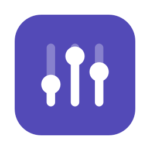

<p align="center">
  
</p>

<h1 align="center">PerAppVolume</h1>

<p align="center">
  <b>Control the volume of each app on your Mac independently.</b><br>
  Turn down a loud Webex/Zoom call while keeping your music, videos or WhatsApp voice notes loud.
</p>

<p align="center">
  🇺🇸 English · <a href="README.es.md">🇪🇸 Español</a>
</p>

---

macOS only has one volume control for everything. PerAppVolume adds what Windows has had for years: **a volume slider for every app**, right in your menu bar.

- 🎚️ **Per-app volume** from 0% to **200%** (boost apps that are too quiet)
- 📋 **Every open app** is listed, with a **green dot** on the ones playing sound right now
- 🔊 **System volume** slider and mute for your current output device, in the same panel
- 🔇 **Mute** a single app without touching the others
- 💾 **Remembers** each app's volume, even after restarting your Mac
- 🖥️ **Menu bar panel** plus an optional **larger window**
- 🚀 **Open at login** (can be turned off in Settings)
- 🌍 **English and Spanish**, switchable in Settings
- 🎧 **Follows your output device**: switch from speakers to AirPods and it keeps working
- 🧩 **No drivers, no admin password**: uses Apple's native Core Audio *process taps*. To uninstall, just delete the app
- 🆓 Free and open source (MIT)

## Requirements

- macOS **14.2 (Sonoma) or newer**
- Apple Silicon or Intel Mac (universal app)

## Install

### One command

Open **Terminal** and run:

```bash
curl -fsSL https://raw.githubusercontent.com/<your-user>/PerAppVolume/main/scripts/install.sh | bash
```

It downloads the latest release, installs it in **Applications**, removes the download quarantine (so macOS doesn't block it) and opens the app. You'll find it in the menu bar; continue with [Permission](#permission-system-audio-recording).

> 🤖 **Using an AI agent** (Claude Code, Codex, Cursor…)? Ask it to “install PerAppVolume following AGENTS.md”. See [AGENTS.md](AGENTS.md).

### Manual

1. Go to the [**Releases**](../../releases/latest) page of this repository and download `PerAppVolume-x.y.z.zip`.
2. Double-click the zip to unzip it and drag **PerAppVolume.app** into your **Applications** folder.
3. Open it. Because the app isn't notarized by Apple (that requires a paid developer account), macOS will block it the first time:
   - Go to **System Settings › Privacy & Security**, scroll down and click **Open Anyway** next to the PerAppVolume message, then confirm.
   - Or run this once in Terminal:
     ```bash
     xattr -dr com.apple.quarantine /Applications/PerAppVolume.app
     ```
   - ⚠️ On **macOS 15 (Sequoia) and newer**, the old trick of right-clicking the app and choosing *Open* **no longer works**. Use one of the two options above.
4. Look for the **sliders icon** in the menu bar (top right of your screen).

> **Why the warning?** macOS only opens apps without asking when they are *notarized* by Apple, which requires the Apple Developer Program (US$99/year). PerAppVolume is free and signed locally (“ad-hoc”) instead, so macOS shows this warning once. It doesn't mean the app is harmful: the full source code is in this repository, and you can [build it yourself](#build-from-source) if you prefer.

### Permission: “System Audio Recording”

The first time you change an app's volume, macOS asks for permission to access **system audio**. Click **Allow**. PerAppVolume needs it to process each app's sound; audio is handled in real time and is **never recorded, saved or sent anywhere**.

If you clicked *Don't Allow* by mistake: **System Settings › Privacy & Security › Screen & System Audio Recording** → enable **PerAppVolume** (in the “System Audio Recording Only” section), then quit and reopen the app.

## How to use

1. Click the **sliders icon** in the menu bar.
2. At the top, **System** controls your Mac's main volume (the same as the volume keys) and shows the current output device.
3. Below, under **Open apps**, you'll see every open app, plus background apps that have played audio. A **green dot** means the app is playing sound right now; those appear first. You can set an app's volume before it starts playing.
4. Move an app's slider. **100%** is its normal volume; the slider snaps there when you get close.
5. Click the **speaker icon** to mute/unmute that app.
6. Right-click an app for **Reset to 100%**.
7. **Open Window** shows a larger mixer; **Settings…** opens the preferences.

Each app's volume is *relative* to the system volume: with System at 50% and Webex at 50%, Webex plays at about a quarter of the maximum. Your Mac's volume keys keep working and the System slider follows them.

### Settings

| Option | What it does |
| --- | --- |
| **Open at login** | Starts PerAppVolume automatically when you log in. Turned on the first time you run it from Applications; turn it off anytime. |
| **Language** | *Same as system*, *English* or *Español*. Changes instantly. |
| **Reset all volumes** | Puts every app back to 100%. |
| **Permissions** | Shortcut to the macOS privacy settings. |

## Uninstall

1. Click the menu bar icon › **Quit**.
2. Drag **/Applications/PerAppVolume.app** to the Trash.

That's it — no drivers or system files are installed. (Optional: delete saved preferences with `defaults delete io.github.perappvolume.PerAppVolume`.)

## Build from source

You only need the free **Xcode Command Line Tools** (full Xcode is not required):

```bash
xcode-select --install
```

```bash
git clone https://github.com/<your-user>/PerAppVolume.git
```

```bash
cd PerAppVolume && make install
```

| Command | Result |
| --- | --- |
| `make app` | Builds `build/PerAppVolume.app` (universal) and `build/PerAppVolume-<version>.zip` |
| `make install` | Builds and copies the app to `/Applications` |
| `make run` | Builds and opens the app |
| `make icon` | Regenerates the app icon |
| `ARCHS=arm64 make app` | Faster build for Apple Silicon only |

`PerAppVolume --list` (the binary inside the app) prints the apps Core Audio sees, which helps with troubleshooting:

```bash
/Applications/PerAppVolume.app/Contents/MacOS/PerAppVolume --list
```

### Publishing a release

The included GitHub Actions workflow (`.github/workflows/release.yml`) builds the app on every push. To publish a downloadable version:

1. Update `CFBundleShortVersionString` in `AppBundle/Info.plist` (e.g. `1.1.0`).
2. Commit, then create and push a tag:
   ```bash
   git tag v1.1.0 && git push origin v1.1.0
   ```
3. The workflow creates a GitHub Release with `PerAppVolume-1.1.0.zip` attached.

## How it works

For each app whose volume you change, PerAppVolume:

1. Creates a **Core Audio process tap** (macOS 14.2+) that captures that app's audio and mutes its original output (`mutedWhenTapped`).
2. Creates a private **aggregate device** that combines the tap with your current output device.
3. Copies the captured audio to the output, multiplied by your chosen volume (with smoothing, so changes don't click).

Apps at 100% aren't touched at all. If PerAppVolume quits or crashes, macOS automatically un-mutes the apps, so you never lose sound.

```
Sources/PerAppVolume/
├── Audio/
│   ├── AppTap.swift               # process tap + aggregate device + real-time gain
│   ├── AudioProcessScanner.swift  # finds audio processes and groups helpers by app
│   ├── SystemVolume.swift         # main volume / mute of the output device
│   └── CoreAudioHelpers.swift     # Core Audio HAL helpers
├── Views/                         # SwiftUI: menu panel, mixer window, settings
├── MixerModel.swift               # state, saved volumes, keeps taps in sync
├── Localization.swift             # English / Spanish strings
├── LaunchAtLogin.swift            # SMAppService wrapper
└── main.swift                     # entry point (+ --list)
```

## Known limitations

- **Browsers count as one app.** All tabs of Arc, Chrome, Safari, etc. share one slider (macOS plays web audio from a single helper process).
- An app's audio may take about a second to adapt the first time you move its slider, or when you switch output devices.
- Boosting above 100% can distort audio that is already loud.
- Apps without a `.app` bundle (command-line tools such as `afplay`) aren't listed.

## Troubleshooting

- **An app goes silent when I move its slider** → the system audio permission is missing. See [Permission](#permission-system-audio-recording).
- **After updating the app it asks for permission again** → normal for ad-hoc signed apps: each build has a new signature. Allow it again.
- **“Open at login” shows a warning** → approve it in **System Settings › General › Login Items**.
- **An app doesn't appear** → apps with a Dock icon are always listed. Background apps (without a Dock icon) only appear once they have played audio since PerAppVolume started.
- **The System slider is greyed out** → some outputs (for example HDMI monitors or certain USB interfaces) don't let macOS change their volume. Use the device's own controls.

## Contributing

Issues and pull requests are welcome. Please keep user-facing strings in both languages (`Sources/PerAppVolume/Localization.swift`) and the docs in sync (`README.md` and `README.es.md`).

## License

[MIT](LICENSE)
